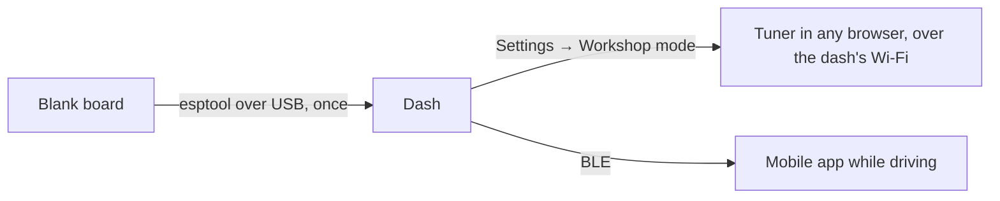

# CANShift

CANShift turns a small ESP32 touch screen into a dashboard for your car. Wired to
the CAN bus through a transceiver, it decodes the frames your ECU already
broadcasts (RPM, temperatures, pressures, lambda, gear, speed) and draws them on
pages you design yourself. No proprietary tooling and no cloud: the dash, a
browser and an optional phone app are the whole system.

This repository holds the firmware that runs on the dash, and it is the front door
for the whole project: releases ship from here, and the documentation for building,
flashing and using a dash lives in [`docs/`](docs/README.md).

## The project

| Repository                                                     | Role                                                                                                   |
| -------------------------------------------------------------- | ------------------------------------------------------------------------------------------------------ |
| **canshift-firmware** (here)                                   | ESP32 firmware: C++17, Arduino, LVGL 8.4, Rust modules. Releases and project docs.                     |
| [canshift-core](https://github.com/CANShift/canshift-core)     | The shared contracts: config schemas, migrations, wire protocol. Published as `@canshift/core` on npm. |
| [canshift-tuner](https://github.com/CANShift/canshift-tuner)   | The configurator: page editor, ECU profiles, signals, live values, firmware upload.                    |
| [canshift-mobile](https://github.com/CANShift/canshift-mobile) | The iPhone companion: telemetry and lap timing over BLE while driving.                                 |

Brand assets and design references live in
[canshift-brand](https://github.com/CANShift/canshift-brand). The firmware mirrors
core's schemas in C++ and pins the schema version it was built against
(`core-schema-version.txt`), so a change to the contract lands here first.

## How a dash is used



1. **First flash.** A blank board gets its firmware once, from a terminal, with
   `esptool`. [First flash](docs/guide/first-flash.md) has the steps for each
   board family.
2. **Workshop mode — configure.** A button in the dash's Settings panel turns
   Bluetooth off, brings up a password-protected Wi-Fi access point, and serves the
   tuner from the dash's own flash. Any phone or laptop browser opens it: no
   Chrome, no cable, no install. Pages, signals, CAN settings and firmware updates
   all happen there. Leaving workshop mode reboots the dash.
3. **Drive.** Back on the dashboard, the mobile app connects over BLE for
   telemetry and lap timing.

> [!IMPORTANT]
> **Workshop mode is in progress, not shipped.** The design is
> [Workshop mode](docs/architecture/workshop-mode.md); the first firmware slice is
> open as #300, and the later slices (access point, server, on-board tuner) are not
> built yet. Until they ship, the tuner configures the dash over a USB cable from
> a Chromium browser, which is also how the 4 MB boards below keep working.

## Supported boards

The firmware is one image per chip family. Every LCD and touch driver is compiled
in, and the board is resolved at boot from its profile
([Board profile](docs/architecture/board-profile.md)).

| Board (`env`)                                             | Chip     | Flash | PSRAM        | Display               | Touch               | Tuner on board | Status                            |
| --------------------------------------------------------- | -------- | ----- | ------------ | --------------------- | ------------------- | -------------- | --------------------------------- |
| Waveshare ESP32-S3-Touch-LCD-2.8 (`waveshare_s3_28`)      | ESP32-S3 | 16 MB | 8 MB OPI     | ST7789T3, 240×320 SPI | CST3530, capacitive | Yes (planned)  | Hardware-verified, native USB     |
| Elecrow CrowPanel 2.8" (`crowpanel_28`)                   | ESP32    | 4 MB  | none (WROOM) | ILI9341, 320×240 SPI  | XPT2046, resistive  | No             | Hardware target, CH340 USB        |
| Generic ESP32 + ILI9341 (`generic_ili9341`)               | ESP32    | 4 MB  | optional     | ILI9341, 320×240 SPI  | XPT2046, resistive  | No             | CI-built profile, pins unverified |
| Generic ESP32 + ILI9341 + GT911 (`generic_ili9341_gt911`) | ESP32    | 4 MB  | optional     | ILI9341, 320×240 SPI  | GT911, capacitive   | No             | CI-built profile, pins unverified |

`generic_esp32s3` also builds in CI as a compile target, but it is not released:
the `esp32s3` image carries the 16 MB partition table of the Waveshare board.

### Why the 4 MB boards get no workshop mode

The on-board tuner needs the 16 MB flash layout, and only the Waveshare board has
it today. On a 4 MB board:

- **Flash.** The firmware already fills about 90 % of each 1.5 MB app slot, with no
  room left for a Wi-Fi stack and a web server, and SPIFFS is 832 KB shared with
  config, fonts and icons. The 16 MB layout gives 4 MB app slots and 7.5 MB of
  SPIFFS for the gzipped tuner.
- **Memory.** Wi-Fi and BLE share one radio, and running an access point and its
  server needs heap. The ESP32-WROOM has no PSRAM, and once LVGL owns its pool the
  largest free block is around 13–18 KB. The S3 has 8 MB of PSRAM.

The 4 MB boards still do everything else: the full dashboard, CAN decoding,
configuration and firmware updates over USB from the tuner, and the mobile app
over BLE. They just never show the workshop button. The budgets are in
[Flash layout](docs/reference/flash-layout.md).

To run CANShift on a board that is not listed, provision its profile over USB or
add it to the catalog: [Adding a board](docs/reference/add-a-board.md).

## Quick start

1. Get the board and a CAN transceiver: [Hardware & BOM](docs/reference/hardware-bom.md).
2. Download `canshift-<chip>-vX.Y.Z-merged.bin` and `-spiffs.bin` from
   [Releases](https://github.com/CANShift/canshift-firmware/releases).
3. Flash both with `esptool`: [First flash](docs/guide/first-flash.md).
4. Wire the transceiver to the board's TWAI pins and the car's CAN-H / CAN-L:
   [CAN header](docs/reference/pinout-can.md).
5. Pick your ECU profile and lay out your pages in the tuner.

## Build from source

You need [PlatformIO Core](https://docs.platformio.org/en/latest/core/installation/index.html)
and the Espressif Rust toolchain, because every board build links the crates
under [`rust/`](rust/):

```bash
pip install platformio
cargo install espup --locked && espup install
. ~/export-esp.sh                      # in every shell that runs pio

pio run -e waveshare_s3_28             # or crowpanel_28, generic_ili9341, ...
pio run -e waveshare_s3_28 -t upload   # flash the app
pio run -e waveshare_s3_28 -t uploadfs # flash data/ to SPIFFS — a separate step
pio test -e native                     # host unit tests
cd rust && cargo test --workspace      # Rust crate tests
pio run -e sim                         # SDL simulator, see sim/README.md
```

A change under `data/` only reaches the board with `uploadfs`. On the ESP32,
`[env:debug]` raises the log level; the rest of the knobs are in
[Build flags](docs/reference/build-flags.md). Sibling checkouts of the other repos
and the CI each one runs: [Dev setup](docs/contributing/dev-setup.md).

## Documentation

Start at [`docs/README.md`](docs/README.md). The main entry points:

| You want to…                  | Read                                                                                                                                                                  |
| ----------------------------- | --------------------------------------------------------------------------------------------------------------------------------------------------------------------- |
| Understand what the dash does | [What is CANShift?](docs/guide/overview.md)                                                                                                                           |
| Flash a board                 | [First flash](docs/guide/first-flash.md) · [Flash layout](docs/reference/flash-layout.md)                                                                             |
| Use the dash in the car       | [Navigating pages](docs/guide/navigating-pages.md) · [Settings panel](docs/guide/settings-panel.md)                                                                   |
| Build the hardware            | [Hardware & BOM](docs/reference/hardware-bom.md) · [Pinout](docs/reference/pinout.md) · [Physical buttons](docs/reference/physical-buttons.md)                        |
| Connect your ECU              | [ECU integration](docs/reference/ecu-integration.md) · [CAN integration](docs/reference/can-integration.md)                                                           |
| Understand the firmware       | [Architecture overview](docs/architecture/overview.md) · [USB transport](docs/architecture/usb-transport.md) · [BLE transport](docs/architecture/ble-transport.md)    |
| Follow the workshop mode work | [Workshop mode](docs/architecture/workshop-mode.md)                                                                                                                   |
| Match the dash design         | [Dash design system](docs/design/DASH_DESIGN_SYSTEM.md), the binding spec                                                                                             |
| Ship a release                | [Release process](docs/contributing/release-process.md) · [Firmware signing](docs/reference/firmware-signing.md) · [Secure boot](docs/reference/secure-boot-setup.md) |

[Releases](https://github.com/CANShift/canshift-firmware/releases) are the
changelog.

## Contributing

Bug reports, board bring-up notes and pull requests are welcome in
[issues](https://github.com/CANShift/canshift-firmware/issues). Before opening a
PR, read [`CLAUDE.md`](CLAUDE.md) for the code shape the review holds every change
to, and [Testing](docs/contributing/testing.md) for the suites CI runs.

- Branches are `type/short-description`; commits follow Conventional Commits,
  subject line only.
- clang-format 22.1.8 gates every PR over `src`, `include`, `test` and `sim`
  (`pip install clang-format==22.1.8`); the same workflow runs `cargo fmt`,
  `clippy` and `cargo test` on the Rust crates.
- PRs merge by rebase only, once `lint` and `ci-success` pass.
- A change to `@canshift/core` is delivered with its firmware and tuner sides in
  the same piece of work.

## License

[MIT](LICENSE).
