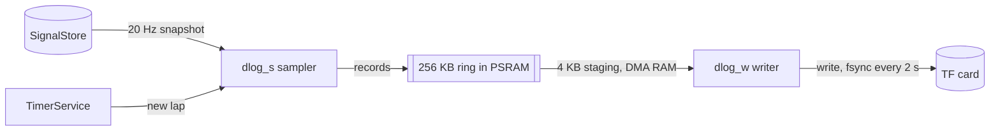
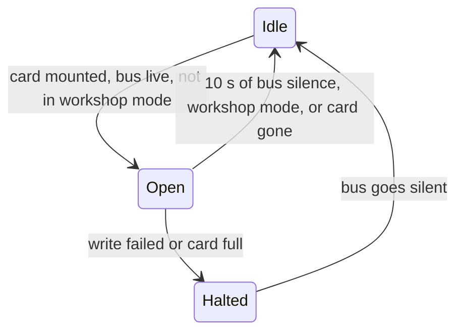

# On-device datalog

Sources: [`src/runtime/datalog/`](../../src/runtime/datalog),
[`src/hal/storage/sd_card.cpp`](../../src/hal/storage/sd_card.cpp),
[`src/hal/wifi/workshop_logs.cpp`](../../src/hal/wifi/workshop_logs.cpp),
[`rust/datalog/`](../../rust/datalog)

The dash records every signal and every lap to the TF card, so a track day
is logged without a phone or a laptop in the car. Files come off the card in
workshop mode, over the same Wi-Fi server that serves the tuner.

## Boards

The datalog is compiled only with `APP_SD_DATALOG_ENABLED`, and it runs only
when the board profile reports `storage.sd_present` with an `sd_bus` of
`Sdmmc1Bit`. Every other board is unchanged: no task, no buffer, no flash.

| Board                            | Slot         | CLK | CMD |  D0 | D3 (held high) |
| -------------------------------- | ------------ | --: | --: | --: | -------------: |
| Waveshare ESP32-S3-Touch-LCD-2.8 | SDMMC, 1 bit |  14 |  17 |  16 |             21 |

SDMMC is its own peripheral, so the card never shares the display SPI bus.
D1 (18) and D2 (15) are wired to the card but unused in 1-bit mode.

> [!WARNING]
> GPIO 17 is also the Waveshare profile's default TWAI TX pin, so the card and
> a CAN transceiver wired to the defaults cannot both run. No environment sets
> `APP_SD_DATALOG_ENABLED` until the board's CAN pins are settled.

## Tasks



| Task     | Core | Priority | Job                                                         |
| -------- | ---: | -------: | ----------------------------------------------------------- |
| `dlog_s` |    1 |        5 | Encodes one sample every 50 ms, plus a lap record per lap   |
| `dlog_w` |    0 |        2 | Mounts the card, opens and closes sessions, drains the ring |

The CAN and UI tasks never touch the card. A card write can stall for
hundreds of milliseconds; the ring absorbs that, and when it is full the
sampler drops whole records and counts them rather than block. The count
lands in the session's END record.

## Session lifecycle

The decision lives in the Rust `datalog` crate (`session.rs`); the writer only
executes the action it returns.



- A session is one file, `/sdcard/logs/S00001.csl`, numbered from a counter
  in the `datalog` NVS namespace. A name that already exists is skipped, never
  overwritten.
- Entering workshop mode closes the session, so every file the tuner can
  download is complete.
- A power cut is the normal end of a drive. The writer calls `fsync` every two
  seconds, and every record carries a CRC, so a decoder keeps everything up to
  the last whole record.

## Failures

Each failure is reported once, on the error bar (`ErrorStore`):

| Code        | When                                          | Then                                |
| ----------- | --------------------------------------------- | ----------------------------------- |
| `sd_absent` | No card mounts at boot                        | Mount retried every 30 s, silently  |
| `sd_full`   | A write returns `ENOSPC`                      | Session halted until the bus sleeps |
| `sd_write`  | Any other write error, a removed card         | Card unmounted, mount retried       |
| `datalog`   | No PSRAM for the ring, or no DMA RAM to stage | Datalog off for this boot           |

A full card refuses new sessions: every drive reports `sd_full` once and
records nothing until logs are deleted from the tuner. Old logs are never
deleted automatically.

## File format

Little-endian throughout. The decoder is `decodeDatalog` in `@canshift/core`
(`./wire`); `test/test_datalog_frame` pins the byte vectors both sides share.

The file starts with `"CSLG"` and the format version (1), then records:

```
[type u8][payload length u16][payload][crc16 u16]
```

The CRC is CRC-16/CCITT-FALSE over the type, the length and the payload.

| Type | Record | Payload                                                                                           |
| ---: | ------ | ------------------------------------------------------------------------------------------------- |
|    1 | HEADER | sample period ms u16, session u16, signal count u8, then id u8 + name length u8 + name per signal |
|    2 | SAMPLE | t ms u32 since session start, valid-slot mask u64, one f32 per set bit, in slot order             |
|    3 | LAP    | t ms u32, lap index u16, lap time ms u32                                                          |
|    4 | END    | t ms u32, records dropped u32                                                                     |

The header carries the signal catalogue by name, so a file stays readable
after the catalogue's ids move. A decoder skips record types it does not
know.

## Getting files off the dash

In workshop mode the server answers three routes besides the tuner itself:

| Method   | Route                  | Answer                                                      |
| -------- | ---------------------- | ----------------------------------------------------------- |
| `GET`    | `/api/logs`            | `{"card":true,"logs":[{"name":"S00001.csl","bytes":1234}]}` |
| `GET`    | `/api/logs/S00001.csl` | The file, `application/octet-stream`, as an attachment      |
| `DELETE` | `/api/logs/S00001.csl` | `204`, or `404` when the file is not there                  |

Only names the dash writes (`S` + five digits + `.csl`) are accepted, so a
route can never reach outside the log directory.

Every route answers only the tuner that holds the workshop socket, under the
same rules as `/ws`:

| Check                                                                             | Refusal         |
| --------------------------------------------------------------------------------- | --------------- |
| `Origin`, when sent, is the dash itself (its access-point IP or `canshift.local`) | `403 Forbidden` |
| The request comes from the host that holds `/ws`                                  | `409 Conflict`  |

A second phone on the access point, or a page served from elsewhere, can
neither read nor delete a session. A tuner whose socket is reconnecting gets
`409` until it is back.
