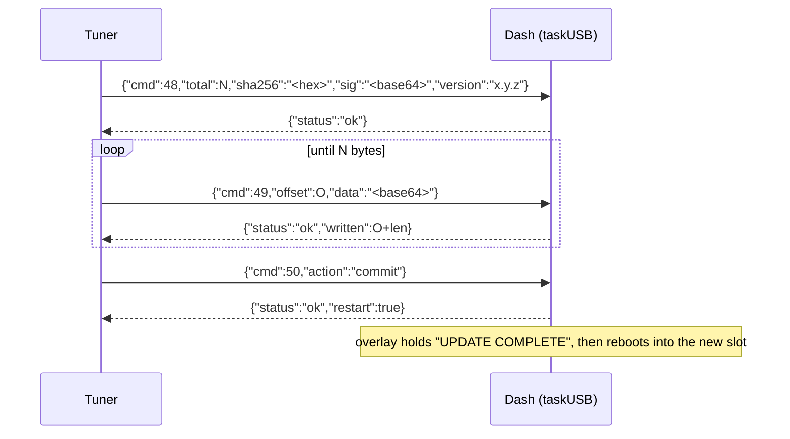

# Firmware OTA

Sources: [`usb_dispatch_ota.cpp`](../../src/hal/usb/usb_dispatch_ota.cpp),
[`ota_receiver.cpp`](../../src/runtime/ota_receiver.cpp)

A firmware update streams into the app slot the dash is not running from. The
bootloader switches slots on the next boot
([Flash layout](../reference/flash-layout.md)). The same three commands work
on both host links: USB, and the workshop socket on the 16 MB boards
([Transports](transports.md)). Both feed one `handleCommand()`, and each
reply goes back only on the link its command came from.

## The flow

1. `CMD_OTA_BEGIN` carries the image size, its SHA-256 and `sig`: the
   release's 64-byte Ed25519 `.sig`, in base64. The dash refuses a size that
   does not fit the slot. It refuses a missing `sig` (`ota_unsigned`) and a
   `sig` that is not 64 bytes of canonical signature (`ota_bad_signature`)
   before touching flash. It opens the slot for sequential writes,
   so `BEGIN` returns at once: each chunk erases the sectors it is about to
   fill, rather than `BEGIN` erasing the whole image up front.
2. `CMD_OTA_WRITE` streams base64 chunks in order. `offset` must equal the
   bytes written so far. A gap, an overrun, or a first chunk that is not an
   app image aborts the transfer. The chunk is decoded in place in the line
   that carried it, so no transport-specific buffer is involved.
3. `CMD_OTA_END` with `"commit"` hashes what was written. It refuses the slot
   switch on a SHA-256 mismatch (`sha256_mismatch`) or when the image does not
   verify against the release key (`ota_bad_signature`). Otherwise it replies
   `{"status":"ok","restart":true}`, holds the completion screen for
   `OTA_COMPLETE_SCREEN_HOLD_MS` and reboots. `"abort"`, the default, discards
   the slot.

## Limits a host must respect

| Limit | Value | Why |
| --- | --- | --- |
| One command in flight | wait for each `status` before the next | the tuner's `AckQueue` resolves on the next `status` line |
| Line or frame size | under `USB_RX_BUF_SIZE` (16 640 B) | the USB line buffer; the socket closes on a bigger frame |
| Chunk size | 12 KB of raw data or less (16 KB of base64) | fits the line with its JSON envelope |
| Reply time | well under the 5 s default ack timeout | a 12 KB chunk erases three sectors and writes them, roughly 0.2 s |

## What the dash checks, and what it does not

Every image is checked against the release signing key on both links, with no
exception in any shipped build:

| Check | Where | Refusal |
| --- | --- | --- |
| `sig` present | `BEGIN` | `ota_unsigned` |
| `sig` is 64 bytes, canonical | `BEGIN` | `ota_bad_signature` |
| app-image header | first chunk | `not_app_image` |
| SHA-256 of the whole image | commit | `sha256_mismatch` |
| Ed25519 over the whole image, against the embedded release key | commit | `ota_bad_signature` |

The signature is verified as the chunks stream in (`rust/ota-signature`, built on
`ed25519-dalek`'s incremental verifier), so the image never has to fit in RAM, and
nothing becomes bootable until it verifies. The public key is
`keys/firmware-signing-public.pem`, compiled in at build time
([Firmware signing](../reference/firmware-signing.md)). Anyone who can reach the
dash, whether on its Wi-Fi or with a cable, can still upload, but only an image
signed by the release key will boot.

A debug build may accept unsigned images when built with
`PLATFORMIO_BUILD_FLAGS="-DAPP_DEBUG_BUILD=1 -DAPP_OTA_ALLOW_UNSIGNED=1"` and
logs a warning when it does. The flag cannot reach a release:
`include/app_config.h` refuses to compile it without `APP_DEBUG_BUILD`, and the
`lint` job (`scripts/check_release_flags.py`) fails if `platformio.ini` names it.

The firmware marks the new slot valid only after a stable boot
([Boot sequence](boot-sequence.md)), so a bootloader built with app rollback
returns to the previous slot when the new image crashes first. The flag that
asks for it, `CONFIG_BOOTLOADER_APP_ROLLBACK_ENABLE`, sits in
`platformio.ini`, but arduino-esp32 ships a prebuilt bootloader that the flag
does not rebuild.

## Over the workshop socket

- The overlay shows over the workshop card. A failed update can be dismissed
  back to the card.
- The reboot drops the socket, and the dash boots back to the dashboard, not
  into workshop mode. The tuner's reconnect therefore fails until the driver
  enters workshop mode again. That is expected: leaving workshop mode is a
  reboot.
- The restart only waits for the USB serial buffer to drain when a USB host has
  sent bytes in the last 5 s. With no host reading, the native-USB S3's
  `Serial.flush()` never returns, which used to hang the reboot until the task
  watchdog fired.
