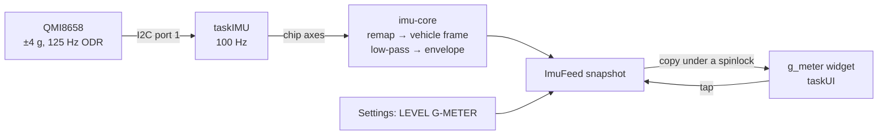

# IMU and the g-meter

Boards with an onboard accelerometer drive the `g_meter` widget: lateral and
longitudinal acceleration as a dot on a friction circle, the peak envelope, and
the combined reading in g. Today that is the Waveshare ESP32-S3-Touch-LCD-2.8
and its QMI8658.

## Which boards have one

The board profile says so, in `imu` (see [Board profile](board-profile.md)):

| Field                              | Meaning                                                                              |
| ---------------------------------- | ------------------------------------------------------------------------------------ |
| `driver`                           | `None` or `QMI8658`                                                                  |
| `pin_sda`, `pin_scl`               | The IMU's I2C bus                                                                    |
| `i2c_addr`, `freq_hz`              | Its address and clock                                                                |
| `screen_x`, `screen_y`, `screen_z` | Which chip axis, and which sign, points screen-right, screen-up and out of the glass |

On the Waveshare the QMI8658 sits on its own bus — SDA 11, SCL 10, address
`0x6B`, shared only with the PCF85063 clock at `0x51`. The CST3530 touch
controller is on a different bus (SDA 1, SCL 3) and owns I2C port 0; the IMU
takes port 1, so the two never contend.

A blob without `imu` describes a board without one, so profiles written before
the field existed still load.

## Zero cost without one

`ImuService::init()` runs with the other runtime services, before the first
page is built. When the profile says `None` it logs once and returns: no I2C
bus is opened, no task is created, no memory is reserved. The only cost on an
IMU-less board is the code in the image.

A `g_meter` widget on such a board stays visible and renders its unavailable
state: lock-coloured rule and guides, and the reason in the kicker, `G · NO IMU`.
A config is portable between boards, so the widget states why it is empty
rather than disappearing.

## The sampling path

The C++ side owns the bus and the task; everything that can be tested on a host
lives in the `imu-core` crate:

| Step          | What it does                                                                                         |
| ------------- | ---------------------------------------------------------------------------------------------------- |
| Remap         | Chip axes to screen axes, from the profile's `screen_*` fields                                       |
| Vehicle frame | Screen axes to lateral and longitudinal, from the level calibration below                            |
| Low-pass      | One pole, α 0.24 at 100 Hz — about 5 Hz, enough to drop engine and road vibration                    |
| Peak envelope | Highest combined g seen in each of eight 45° sectors, for the session; a tap on the widget resets it |
| Plot geometry | Range and radius to a pixel offset, clamped to the ring                                              |

A read failure is skipped; fifty in a row log once and push `IMU_READ`. The
widget treats a snapshot older than 250 ms as stale and renders `- -`.

## Orientation and levelling

The dot plots **felt force**: braking moves it up, accelerating moves it down,
a left-hand corner moves it right — the way the driver is pushed.

Until it is levelled, the firmware assumes the screen stands upright and faces
the driver. **LEVEL G-METER** in the [Settings panel](../guide/settings-panel.md)
measures the real mounting:

1. Park on level ground, engine running or not, and tap the row.
2. The dash averages one second of samples. It refuses a car that is moving (a
   spread above 0.03 g), a reading far from 1 g, or a screen mounted so flat
   that "forward" cannot be told apart from "up".
3. The measured gravity sets the vehicle frame: up is gravity, forward is the
   horizontal part of the direction the screen faces, negated, and lateral
   completes the frame.
4. Gravity is stored in NVS, namespace `imu`, key `level`, and applied on every
   later boot. A failed write is reported as `LEVELLED - NOT SAVED`.

Levelling handles any tilt and any lean. It assumes the screen faces backwards
toward the driver; a dash mounted sideways is not described.

## Bench checks

The axis map in the Waveshare profile is a starting point taken from the board's
layout, not a measurement. On the bench:

| Check                                          | Expected                                              |
| ---------------------------------------------- | ----------------------------------------------------- |
| Boot log                                       | `QMI8658 sampled every 10 ms`, no `IMU_INIT` error    |
| Board flat on the desk, screen up              | Levelling refuses with `SCREEN TOO FLAT`              |
| Board upright, screen facing you, not levelled | Dot at the centre, reading near `0.00 g`              |
| Tilt the top of the screen away from you       | Dot moves up (reads as braking)                       |
| Tilt the right edge down                       | Dot moves right (reads as a left-hand corner)         |
| Level, then repeat                             | Dot returns to the centre after levelling at any tilt |
| Tap the widget                                 | Envelope clears                                       |

A sign that comes out wrong is fixed in `include/boards/waveshare_s3_28.h` by
flipping that axis's `screen_*` entry, and in core's board catalog with it.
