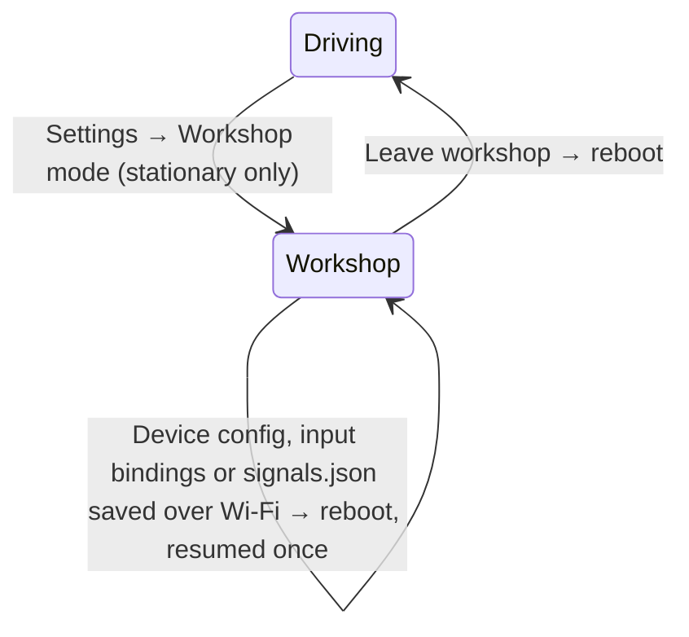

# Workshop mode

Workshop mode turns the dash into its own configurator. One button in the
Settings panel stops the dashboard, switches the radio from Bluetooth to a
Wi-Fi access point, and serves the tuner from flash. Any browser on any
phone or laptop opens it. No Chrome, no USB cable, no install.

## Why

The tuner used to talk to the dash over Web Serial. That meant a desktop
Chromium browser, a cable, and a serial link that resets the board on DTR and
drops bytes on the native-USB S3. None of that works from an iPhone, which is
what a driver has in the garage.

The 16 MB boards have the room to carry the tuner themselves: the `spiffs`
partition in `ota_16mb.csv` is 7.5 MB, and the gzipped tuner is about 0.5 MB.

## The three ways to touch a dash

| Moment                             | Tool                                               | Link               |
| ---------------------------------- | -------------------------------------------------- | ------------------ |
| First flash of a blank board       | `esptool` from a terminal, documented step by step | USB, once          |
| Configuration and firmware updates | The tuner, served by the dash in workshop mode     | Wi-Fi access point |
| Firmware updates from the phone    | The mobile app, Device tab                         | Wi-Fi access point |
| Driving                            | The mobile app                                     | BLE                |

After the first flash, the USB cable is only for recovery.

## Entering and leaving

- **The button sits in the Settings panel** and is only offered while the car
  is stationary (`speed_kph` at 0, or no speed signal mapped).
- **Leaving is a reboot.** Freeing the Bluetooth controller's memory cannot be
  undone without a restart, and a reboot returns every subsystem to a known
  state. No partial teardown to get wrong.
- **A reboot asked for by the workshop tuner comes back to workshop mode,
  once.** A firmware update, a saved device config or input bindings, and an
  accepted `signals.json` upload all reboot the dash, and the tuner on the phone needs the access point back to
  reconnect. So a command that arrives over the workshop socket stores a
  one-shot `resume` reason (`update` or `config`) in the `workshop` NVS
  namespace before the reboot. The next boot clears it before anything else
  and re-enters workshop mode, with the same card and credentials, when the
  board supports workshop mode and the reason still holds:

  | Reason   | Also requires                                    | Why                                                        |
  | -------- | ------------------------------------------------ | ---------------------------------------------------------- |
  | `update` | the running image is the new one, pending verify | a rollback lands in driving mode, not on a broken workshop |
  | `config` | nothing                                          | the image did not change                                   |

  After an `update` resume, the new image is still pending verify. It is
  marked valid on Leave once it has been up for 60 s
  ([OTA mark-valid placement](boot-sequence.md#ota-mark-valid-placement)).
  Leaving sooner rolls the update back.

  The stationary rule is skipped for that entry: the car was already
  stationary when the driver entered workshop mode. Because the flag is
  cleared before the resume, a crash loop lands in driving mode, and the same
  commands over USB never store it.

- **The screen locks to a workshop card**: "Workshop mode, dash disabled", the
  network name, its password, and a QR code that joins the network in one scan.
  Touch does nothing on that card except the Leave button.

## What runs in workshop mode

| Subsystem               | State                                     | Reason                                                        |
| ----------------------- | ----------------------------------------- | ------------------------------------------------------------- |
| BLE                     | Stopped, controller memory released       | Wi-Fi and BLE share one radio; the RAM goes to the web server |
| Dashboard pages         | Released, only the workshop card is drawn | The LVGL page trees are the largest heap user after BLE       |
| CAN decode              | Running                                   | The tuner shows live values while you map signals             |
| USB                     | Running                                   | Recovery path stays open                                      |
| Wi-Fi                   | Access point, WPA2                        | —                                                             |
| HTTP + WebSocket server | Running                                   | Serves the tuner and carries its commands                     |

The access point is never open. Its password is generated per board on first
entry, stored in NVS and shown on the workshop card, so a stranger in the same
car park cannot reach the dash.

## One protocol

The tuner's WebSocket carries the same newline-delimited JSON lines as USB.
They go into the same `handleCommand()` dispatcher
([USB transport](usb-transport.md)), so config push and pull, CAN scan, and
firmware OTA behave the same on both links. The wire contract stays in
`@canshift/core`. Workshop mode adds a transport, not a protocol.

## Offline by construction

A phone on the dash's access point has no internet. Everything the tuner needs
ships in flash: the app bundle, its fonts, and the ECU catalogue. Nothing in the
tuner may fetch from the network. This is also why analytics and the contact
form are gone from it.

A firmware update means downloading the signed `.bin` from
[Releases](https://github.com/CANShift/canshift-firmware/releases) first, then
uploading it with its `.sig` from the tuner. The dash verifies the Ed25519
signature against the release key compiled into it, and switches to the new slot
only when it verifies ([Firmware OTA](firmware-ota.md),
[Firmware signing](../reference/firmware-signing.md)).

## The tuner, reduced

The dash canvas keeps full fidelity against the
[dash design system](../design/DASH_DESIGN_SYSTEM.md); it is the reason the
tuner exists. Everything around it is plain forms, as simple as possible.

| Tab         | Holds                                                                |
| ----------- | -------------------------------------------------------------------- |
| **Dash**    | Page strip, canvas, widget properties                                |
| **Vehicle** | ECU profile, signals, live values, CAN bus settings                  |
| **Device**  | Units, brightness, board, firmware upload, config backup and restore |

Removed: Welcome, Home, Contact, analytics, and the Web Serial flasher.

## Where the code lives

The tuner stays in its own repo,
[canshift-tuner](https://github.com/CANShift/canshift-tuner). It is a Node and
Vite project with its own CI and an npm dependency on `@canshift/core`. Mixing
that toolchain into PlatformIO would slow both pipelines and blur ownership.
The coupling is one artifact: each tuner release publishes a gzipped bundle,
and the firmware build pins a tuner version and copies that bundle into
`data/tuner/` before `uploadfs`. This works like the schema pin, which is
already the firmware's only link to core.

`tuner-version.txt` holds the tuner release tag and the sha256 of its
`canshift-tuner-dash-<tag>.tar.gz`; `python3 scripts/pin_tuner.py vX.Y.Z`
rewrites it. The bundle records the core schema it was built against, and
`scripts/tuner_bundle.py` refuses one older than `core-schema-version.txt`,
so a schema bump needs a tuner release and a re-pin before the next firmware
release. A sibling `../canshift-tuner/dist-tuner/` is used only with
`CANSHIFT_TUNER_SIBLING=1`, and the same gate applies to it
([Transports](transports.md)).

## Boards

Workshop mode needs the 16 MB layout, so today that means
`waveshare_s3_28` only. The 4 MB boards keep USB configuration and get no
workshop button. That is a deliberate limit, not an oversight.

## Delivery slices

Each slice ships and is verified on its own, in this order:

1. **Firmware: workshop mode.** Settings button, BLE stop, workshop card with
   QR, leave by reboot.
2. **Firmware: access point and server.** WPA2 access point, static gzipped
   files from `data/tuner/`, WebSocket into `handleCommand()`.
3. **Tuner: reduction.** Remove Welcome, Home, Contact and analytics; three
   tabs; offline assets.
4. **Tuner: WebSocket transport.** Replaces Web Serial; release publishes the
   bundle.
5. **Firmware: tuner pin.** The build fetches the pinned bundle into
   `data/tuner/`.
6. **Firmware: upload OTA over Wi-Fi.** Signed `.bin` upload from the Device
   tab.
7. **Docs: first flash from a terminal.** `esptool` steps move here from the
   tuner's manual-flash page, and the tuner's install docs go.

## Mobile

The mobile app drives in BLE and updates the firmware over the workshop
socket, like the tuner. It downloads the signed release while the phone still
has internet, joins the access point, and sends the same `BEGIN` / `WRITE` /
`END` lines ([Firmware OTA](firmware-ota.md)). So the dash runs the same
checks whichever app sends the image. After the resumed boot, the app sends
`reboot` over the socket, so the dash comes back in driving mode and BLE
reconnects with the new version
([mobile firmware update](https://github.com/CANShift/canshift-mobile/blob/main/docs/firmware-update.md)).

React Native's WebSocket sends `Origin: http://192.168.4.1`, which the origin
check already allows, so the app needs no exception to the browser rule.
Entering workshop mode stays a tap on the dash: BLE has no command for it, and
it still carries only a fixed command set ([BLE transport](ble-transport.md)).
